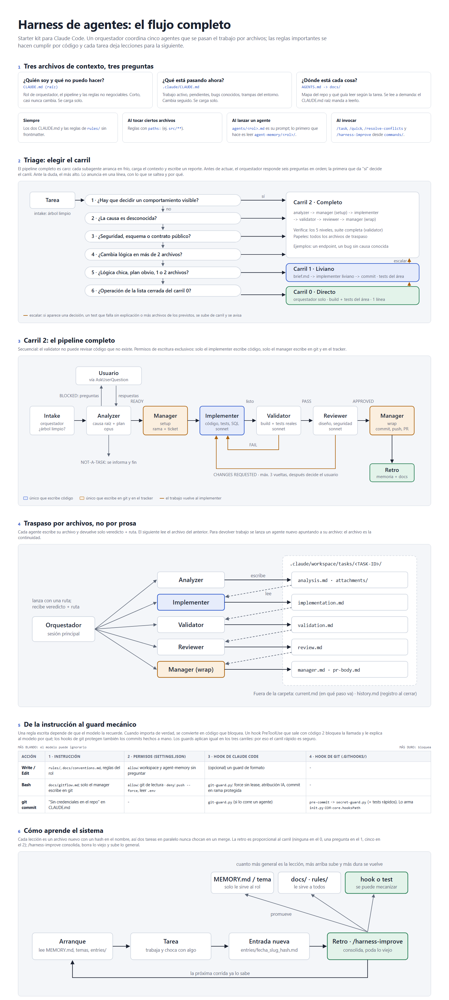

<!-- web-repaso:start -->
# Web de repaso CCDV-F

Web local para repasar los 8 dominios del examen Claude Certified Developer – Foundations.
Requisitos: Node 22+ y npm 10+.

    npm install
    npm run dev        # http://localhost:5173
    npm run build      # genera dist/
    npm run preview    # sirve dist/
    npm run check      # valida data/domains.js

Contenido en `data/domains.js`; fuentes en `../apuntes/`. Debajo sigue la documentación del harness de agentes.

---
<!-- web-repaso:end -->
# Starter kit: harness de agentes para Claude Code

Una estructura mínima para que Claude Code trabaje en un repositorio como un
equipo: un **orquestador** que coordina a cinco agentes especializados, que se
pasan el trabajo **por archivos**, con reglas que se hacen cumplir **por código**
y una **memoria** que acumula lo aprendido en cada tarea.

Está destilado del harness de un proyecto real, donde cada pieza apareció
después de un incidente concreto. El diagrama completo está en
[`diagrama/flujo-harness.png`](diagrama/flujo-harness.png) (también en
[PDF](diagrama/flujo-harness.pdf); la fuente editable es
[`diagrama/flujo-harness.html`](diagrama/flujo-harness.html)).



---

## 1. Instalación

1. Copia el contenido de esta carpeta en la raíz de tu repositorio (excepto
   `README.md`, `diagrama/` y `gitignore.snippet`, que son documentación del kit).
2. Pega `gitignore.snippet` al final de tu `.gitignore`.
3. Corre `python init.py`. Verifica que estén todos los archivos, crea las
   carpetas vacías y configura `git config core.hooksPath .githooks` para que el
   pre-commit quede armado. Hay que correrlo **en cada clon y en cada worktree
   nuevo**: `core.hooksPath` es una configuración por clon.
4. Busca `PERSONALIZAR` y `CUSTOMISE` en todos los archivos y completa lo de tu
   proyecto: rama base, comandos de build y tests, estructura, convenciones.
5. Completa sobre todo dos tablas, que son las que hacen rápido el carril 0:
   "Tests por área" en `docs/testing.md` y "Archivos generados" en `AGENTS.md`.
6. Abre Claude Code en el repo y prueba con `/quick <un cambio chico>`, y después
   con `/task <algo más grande>`.

Requisitos: Python 3 y git. Los hooks buscan un Python que funcione de verdad
(en Windows, `python3` puede ser un alias de la Microsoft Store que no ejecuta
nada) y, si no lo encuentran, se saltan sin romper.

---

## 2. Qué hay en el kit

```
CLAUDE.md                      quién eres: rol de orquestador y reglas no negociables
AGENTS.md                      mapa: dónde está cada cosa y cuándo leerla
docs/
  conventions.md               cómo se escribe código aquí
  testing.md                   cómo se escriben y corren los tests
  verification.md              definición de terminado (los niveles del validator)
  gitflow.md                   ramas, commits, push, PRs (lo lee el manager)
.githooks/
  pre-commit                   corre secret-guard antes de cada commit
init.py                        verifica el entorno y arma los hooks de git
gitignore.snippet              líneas para tu .gitignore

.claude/
  CLAUDE.md                    qué está pasando: trabajo activo, pendientes, bugs
  settings.json                permisos (allow / deny) y el hook PreToolUse
  agents/
    orchestrator.md            manual de la sesión principal (no se lanza)
    analyzer.md                ticket -> plan verificado        (opus)
    implementer.md             plan -> código + tests           (sonnet)
    validator.md               vuelve a correr build y tests    (sonnet)
    reviewer.md                revisión independiente           (sonnet)
    manager.md                 rama, commits, push, PR, tracker (sonnet)
  commands/
    task.md                    /task: corre el pipeline completo (carril 2)
    quick.md                   /quick: tarea chica por el carril 0 o 1
    resolve-conflicts.md       /resolve-conflicts: conflictos de merge o rebase (carril 0)
    harness-improve.md         /harness-improve: audita y repara el harness
  hooks/
    git-guard.py               bloquea force push, atribución IA, commits en ramas protegidas
    secret-guard.py            bloquea credenciales en el diff (lo llama el pre-commit)
  rules/
    code-minimalism.md         ejemplo de regla con paths:
  agent-memory/
    README.md                  protocolo de la memoria
    <rol>/MEMORY.md            índice de lecciones consolidadas
    <rol>/entries/             lecciones nuevas, un archivo por lección
  workspace/                   (ignorado por git, salvo el README)
    README.md
    current.md                 tarea en curso y en qué paso va
    history.md                 registro de tareas cerradas
    tasks/<TASK-ID>/           archivos de traspaso de cada tarea (brief.md en carril 1)
```

---

## 3. El flujo, paso a paso

### 3.1 Tres archivos, tres preguntas

| Pregunta | Archivo | Ritmo de cambio | Cómo se carga |
| --- | --- | --- | --- |
| ¿Quién soy y qué no puedo hacer? | `CLAUDE.md` (raíz) | casi nunca | solo, en cada sesión |
| ¿Qué está pasando ahora? | `.claude/CLAUDE.md` | cada semana | solo, en cada sesión |
| ¿Dónde está cada cosa? | `AGENTS.md` -> `docs/` | cuando se mueve código | a demanda |

Se separan porque cambian a ritmos distintos y porque todo lo que se carga solo
gasta contexto en cada sesión. El `CLAUDE.md` raíz se mantiene corto; el detalle
va a `docs/`, que se lee solo cuando hace falta.

### 3.2 Qué entra al contexto y cuándo

- **Siempre:** los dos `CLAUDE.md` y las reglas de `.claude/rules/` **sin** frontmatter.
- **Al tocar ciertos archivos:** las reglas con `paths:` en su frontmatter
  (por ejemplo `src/**`). No gastan contexto en una sesión que solo toca docs.
- **Al lanzar un subagente:** su `agents/<rol>.md` es su prompt completo. Lo
  primero que hace es leer `agent-memory/<rol>/`.
- **Al invocar:** `/task`, `/quick`, `/resolve-conflicts` y `/harness-improve` desde `commands/`.
- **A demanda:** `AGENTS.md`, `docs/`, `workspace/current.md`, `orchestrator.md`.

### 3.3 Carriles: no todo pasa por el pipeline

El pipeline completo es caro: cada subagente arranca en frío, carga el contexto,
redescubre el estado del repo y escribe un reporte. Para una feature vale la pena;
para resolver un conflicto, no. Por eso cada tarea va por uno de tres carriles:

| Carril | Quién | Cuándo | Verificación | Papeles |
| --- | --- | --- | --- | --- |
| **0 · Directo** | El orquestador solo | Operación mecánica de una lista cerrada | Build y tests del área, sin marcadores de conflicto | Una línea en `history.md` |
| **1 · Liviano** | Implementer, y el commit lo hace el orquestador | Cambio de lógica chico, 1 o 2 archivos, plan obvio | Evidencia del implementer + el orquestador vuelve a correr los tests del área | `brief.md` + reporte de 15 líneas |
| **2 · Completo** | El pipeline entero | Lógica nueva, causa desconocida, varios archivos, seguridad, esquema, contrato público | Los 5 niveles de `docs/verification.md` | Todos |

**Cómo se elige.** El orquestador responde seis preguntas en orden (Paso 0b de
`orchestrator.md`) y la primera que da "sí" decide: ¿decide comportamiento?
¿causa desconocida? ¿seguridad, esquema o contrato? ¿lógica en más de 2 archivos?
→ carril 2. ¿Lógica con plan obvio? → carril 1. ¿Está en la lista cerrada? →
carril 0. Ante la duda, el carril más alto. Antes de actuar lo anuncia en una
línea, con lo que se saltea y por qué.

**Ejemplos:**

| Tarea | Carril |
| --- | --- |
| Conflicto en `package-lock.json` después de un merge | 0 (regenerar) |
| Conflicto donde las dos ramas agregaron tests distintos | 0 (unir) |
| Rebase limpio y push de una rama ya aprobada | 0 |
| Corregir un typo en un mensaje de error | 0 |
| Un off-by-one en una función, con su test | 1 |
| Cambiar el valor por defecto de un timeout | 1 |
| Conflicto donde las dos ramas cambiaron la misma validación | 2 (o preguntar) |
| Un bug cuya causa no se conoce | 2 |
| Agregar un endpoint | 2 |

**Escalada.** Si a mitad de camino aparece una decisión de comportamiento, un test
que falla sin explicación o más archivos de los previstos, se sube de carril y se
avisa. Nunca se baja de carril por cuenta propia si el usuario pidió `/task`.

**Por qué el carril rápido es seguro.** Los guards no dependen del carril:
`git-guard.py` y `secret-guard.py` bloquean igual en los tres. Y para que el
carril 0 no frene con un pedido de permiso en cada paso, `settings.json` permite
`git add`, `git commit`, `--continue` y `git push` sin force. Si prefieres que
Claude te pregunte antes de cada commit, saca esas líneas del `allow`.

### 3.4 El pipeline (carril 2)

```
intake -> analyzer -> manager(setup) -> implementer -> validator -> reviewer -> manager(wrap) -> retro
```

| Paso | Qué hace | Escribe | Veredictos |
| --- | --- | --- | --- |
| Intake | El orquestador revisa que el árbol esté limpio y elige el `TASK-ID` | `current.md` | |
| Analyzer | Lee el ticket completo, encuentra la causa real, escribe un plan sin ambigüedades | `analysis.md` | `READY`, `BLOCKED`, `NOT-A-TASK` |
| Manager setup | Crea la rama desde la base, mueve el ticket | `manager.md` | |
| Implementer | Mide la base, escribe código, tests y SQL con rollback; prueba que cada test falla sin el cambio | `implementation.md` + código | `listo`, `bloqueado` |
| Validator | Vuelve a correr build y tests, contrasta cada requisito con evidencia | `validation.md` | `PASS`, `PASS WITH GAPS`, `FAIL` |
| Reviewer | Instancia nueva, sin el contexto del implementer: diseño, seguridad, tests | `review.md` | `APPROVED`, `APPROVED WITH COMMENTS`, `CHANGES REQUESTED` |
| Manager wrap | Commit, rebase, push, ticket a "en revisión", PR | `manager.md`, `pr-body.md` | |
| Retro | El orquestador revisa qué falló en el harness y lo corrige | memoria, `docs/` | |

**Reglas que hacen funcionar el pipeline:**

- **Permisos de escritura exclusivos.** Solo el implementer escribe código; solo
  el manager escribe en git y en el tracker. El orquestador coordina y no implementa.
- **Los subagentes no hablan con el usuario.** Un `BLOCKED` vuelve al
  orquestador, que pregunta con `AskUserQuestion` y devuelve las respuestas.
- **Límite de 3 vueltas.** Un `FAIL` o un `CHANGES REQUESTED` vuelve al
  implementer; a la tercera, decide el usuario.
- **Un should-fix no abre otra vuelta.** `APPROVED WITH COMMENTS` avanza y los
  comentarios van a la tabla de pendientes de `.claude/CLAUDE.md`.
- **Nada se da por terminado por lo que diga un agente.** La evidencia es el
  `PASS` del validator y el `APPROVED` del reviewer.
- **Escala al tamaño del cambio.** El pipeline es el carril 2; lo chico va por el
  0 o el 1 (sección 3.3).

### 3.5 Traspaso por archivos

Cada agente escribe en `.claude/workspace/tasks/<TASK-ID>/` y le devuelve al
orquestador **solo un veredicto y una ruta**. El orquestador pasa rutas; nunca
pega la salida de un agente en el prompt del siguiente, porque resumir en el
medio es donde se pierde el detalle.

Esto da tres cosas:

1. **Se puede retomar.** Un subagente que terminó normalmente no se puede
   reanudar. Se lanza uno nuevo: "lee `analysis.md`, está completo; esto cambió".
2. **Sobrevive a caídas.** Los agentes guardan su archivo mientras trabajan; si
   uno muere a la mitad, el siguiente arranca desde lo parcial.
3. **Una sesión cortada se recupera.** `current.md` dice qué tarea y qué paso.

`workspace/` no se commitea: nada ahí es fuente de verdad, git y el tracker lo son.

### 3.6 De la instrucción al guard mecánico

Una regla escrita depende de que el modelo la lea y la recuerde. Cuando una
regla importa de verdad, se convierte en código que bloquea:

| Capa | Dónde | Qué hace en el kit |
| --- | --- | --- |
| 1. Instrucción | `CLAUDE.md`, `rules/`, `docs/`, `agents/` | Dice qué hacer. El modelo puede ignorarlo. |
| 2. Permisos | `.claude/settings.json` | `allow`: git de lectura, escribir en workspace y memoria sin preguntar. `deny`: `git push --force`, leer `.env`. |
| 3. Hook de Claude Code | `settings.json` -> `hooks/git-guard.py` | Antes de cada comando Bash: bloquea force push sin lease, atribución IA en commits y commits en `main`/`develop`. |
| 4. Hook de git | `.githooks/pre-commit` -> `hooks/secret-guard.py` | Antes de cada commit, incluidos los hechos a mano: bloquea credenciales en las líneas agregadas. |

Cómo funciona un hook `PreToolUse`: Claude Code le pasa la llamada como JSON por
stdin. Si el script sale con código **2**, la llamada se bloquea y lo que
escribió en stderr vuelve al modelo como explicación. Con código 0, la llamada sigue.

Por qué hace falta la capa 4: los hooks de Claude Code solo ven lo que hace
Claude. `secret-guard` también caza los **mensajes de error** que repiten parte
de una credencial (por ejemplo `Keyword not supported: '...'`), porque así es
como un secreto se filtra sin que nadie crea estar pegando un secreto.

Un detalle que conviene respetar: **un guard que molesta de más termina
desactivado.** `secret-guard` solo avisa (no bloquea) en archivos que ya traen
secretos, e ignora valores cortos sin dígitos.

### 3.7 Cómo aprende el sistema

```
arranque (lee su memoria) -> tarea -> entrada nueva en entries/ -> retro / harness-improve
     ^                                                                  |
     +------------------- la próxima corrida ya lo sabe ----------------+
```

- Cada lección es **un archivo nuevo**: `entries/<fecha>_<slug>_<hash>.md`. Si
  todos editaran `MEMORY.md`, dos tareas en paralelo chocarían en la misma línea
  y el merge perdería entradas. Con archivos distintos, eso no puede pasar.
- `MEMORY.md` es un índice que se consolida a mano de vez en cuando.
- **Escalera de promoción:** lo que solo sirve a un rol se queda en su memoria;
  lo que sirve a todos sube a `docs/` o `rules/`; lo que se puede hacer cumplir
  por código se vuelve un hook o un test.
- La **retro** es proporcional al carril: ninguna en el 0, una pregunta en el 1
  ("¿el carril fue el correcto?") y cinco en el 2 (información faltante,
  correcciones del usuario, fallas evitables, docs equivocados, agentes que no
  aportaron). `/harness-improve` hace lo mismo sobre la historia reciente y busca
  formas de falla concretas.

---

## 4. Cómo adaptarlo

- **Menos agentes.** En un proyecto chico: analyzer + implementer + reviewer, y
  el orquestador hace lo del manager. Lo que no conviene quitar es la
  independencia del reviewer.
- **Umbrales de los carriles.** "2 archivos" y "80 líneas" son puntos de partida.
  Ajústalos con lo que muestre `/harness-improve` (carriles sobredimensionados o
  subdimensionados), y amplía la lista cerrada del carril 0 con las operaciones
  mecánicas propias de tu proyecto.
- **Modelos.** El frontmatter de cada agente trae `model:`. El analyzer usa
  `opus` porque un mal análisis arruina todo lo que sigue; el resto, `sonnet`.
  Una política de modelos que solo está escrita en prosa no se aplica: tiene que
  estar en el frontmatter.
- **Tracker.** Agrega a `tools:` del manager (y del analyzer, para leer) las
  herramientas MCP de tu tracker.
- **Autorización de PR.** Decide si el manager crea el PR solo cuando el reviewer
  aprueba o si deja el comando listo. Escríbelo en el `CLAUDE.md` raíz y en
  `docs/gitflow.md`, en un solo lugar cada uno.
- **Más guards.** Candidatos habituales: un guard de formato en `Write|Edit`
  (por ejemplo, solo ASCII en el código), tests rápidos en el pre-commit
  limitados a las carpetas del diff, un guard de mensajes de commit (`commit-msg`).
- **Más reglas.** Una por archivo en `.claude/rules/`, con `paths:` si aplica
  solo a parte del código, y siempre con el motivo o el incidente que la originó.

## 5. Errores comunes

- **Pegar la salida de un agente en el prompt de otro.** Pasa la ruta.
- **Intentar retomar un subagente terminado con `SendMessage`.** Lanza uno nuevo
  apuntando a su archivo.
- **Correr el pipeline completo para algo mecánico.** Un conflicto, un lockfile o
  un rebase son carril 0. Si pasa seguido, revisa el triage y la lista cerrada.
- **Dejar vacía la tabla "Tests por área".** Sin ella, todo corre la suite completa
  y el carril rápido deja de serlo.
- **En el carril 2, correr el build tú mismo para ahorrarte el validator.** Esa
  evidencia vive en `validation.md`; si el validator es caro, achica su alcance.
- **Tratar una lista de should-fix como tareas pendientes.** Van a la cola.
- **Citar un conteo de tests de una tarea anterior.** Se mide de nuevo en la rama actual.
- **Olvidar `python init.py` en un clon o worktree nuevo.** Los hooks de git
  quedan desarmados sin aviso.
- **Dejar que `.claude/CLAUDE.md` crezca sin podar.** Lo resuelto se borra o se
  resume en una línea.
